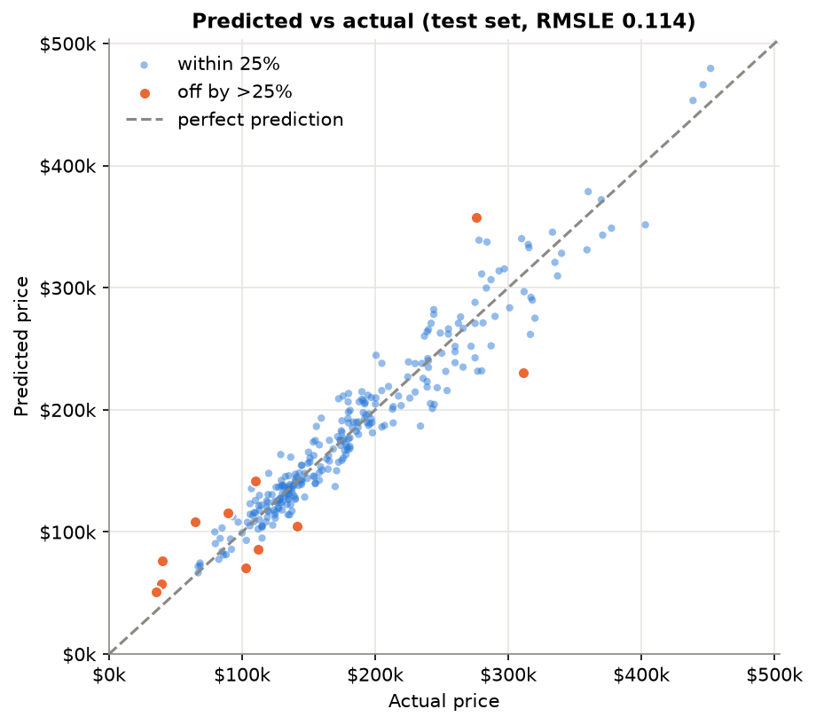
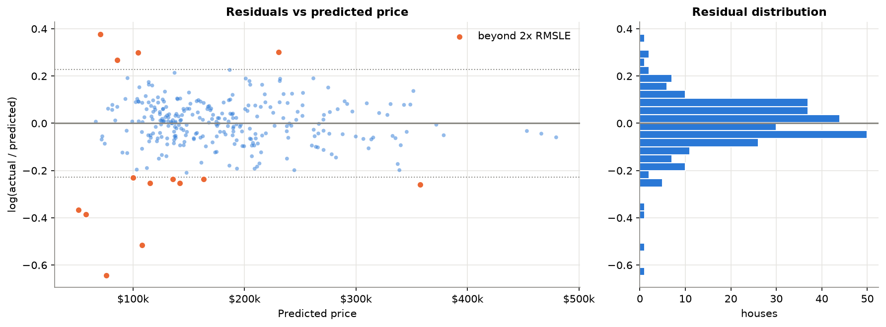
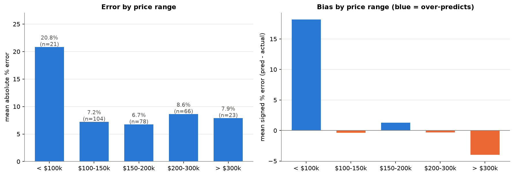
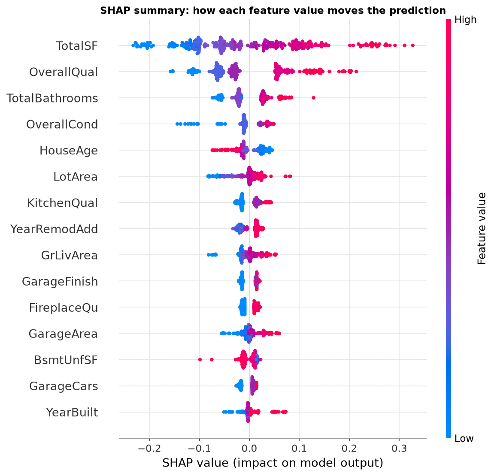

# 🏠 House Price Predictor

Predict house sale prices from property features, compare seven models, explain every prediction with SHAP,
and serve it all in a Streamlit web app. Built on the Ames, Iowa housing dataset with a leakage-free scikit-learn pipeline.

> **Headline result:** tuned XGBoost reaches a **held-out test RMSLE of 0.114** (R² 0.933, MAE $14.2k, median error 6.3%)
> on 292 houses it never saw. See [Results](#results) and [Limitations](#limitations) for what that number does and does not mean.


<!-- TODO: run `streamlit run app/streamlit_app.py`, take a screenshot, and save it as reports/figures/app_screenshot.png -->

## Contents
[Dataset](#dataset) · [Approach](#approach) · [Results](#results) · [Key insights](#key-insights) · [Limitations](#limitations) ·
[Run locally](#run-locally) · [Deploy](#deploy-to-streamlit-community-cloud) · [Future work](#future-improvements) · [What I learned](#what-i-learned)

## Dataset
[Ames Housing](https://www.openml.org/search?type=data&name=house_prices) (De Cock, 2011): 1,460 house sales in Ames, Iowa between 2006 and 2010,
79 features describing size, quality, age, location and amenities. It is loaded without any login through
`sklearn.datasets.fetch_openml(name="house_prices", as_frame=True)` and cached to `data/raw/ames_housing.csv`
so the project also works offline.

## Approach
1. **EDA** ([notebook 01](notebooks/01_eda.ipynb)): the target is right-skewed (skew 1.88 → 0.12 after `log1p`); most "missing" values mean the house
   *has no* pool/garage/basement rather than unknown data; two partial-sale mega-houses are outliers.
2. **Leakage-free feature pipeline** ([src/features.py](src/features.py)), one sklearn `Pipeline` so nothing is ever fit on validation or test data:
   - structural fills (`"None"`/0 for absent features), `LotFrontage` filled with the **training-set neighborhood median**;
   - 8 engineered features: `TotalSF`, `HouseAge`, `YearsSinceRemodel`, `TotalBathrooms`, `HasGarage`, `HasPool`, `HasFireplace`, `PorchSF`;
   - ordinal encoding for 19 ordered columns (quality Ex>Gd>TA>Fa>Po…), one-hot for 25 nominal columns;
   - `log1p` on numeric columns whose *training* skew exceeds 0.75 (21 columns).
3. **Modeling** ([src/train.py](src/train.py)): train on `log1p(price)` and invert with `expm1` (via `TransformedTargetRegressor`), 80/20 split,
   5-fold CV with the whole pipeline refit per fold. Linear Regression, Ridge and Random Forest as baselines; XGBoost and LightGBM with defaults and
   tuned with **Optuna** (60 trials each, minimising CV RMSLE). The final model is chosen by **CV only**; the test set is used once for reporting.
4. **Evaluation and explainability** ([src/evaluate.py](src/evaluate.py)): diagnostic plots, error by price range, SHAP summary and waterfall.
5. **Serving** ([src/predict.py](src/predict.py), [app/streamlit_app.py](app/streamlit_app.py)): validated `predict_price(dict)`, an 80% prediction band, SHAP explanation per prediction.

Everything is seeded (`random_state=42`), and the 31 tests in [tests/](tests) cover the feature pipeline (including a leakage test), the prediction module and the app.

## Results

5-fold CV on the 1,166 training houses and a single evaluation on the 292 held-out houses. Prices in USD.

| Model | CV RMSLE | Test RMSLE | Test RMSE | Test MAE | Test R² |
|---|---:|---:|---:|---:|---:|
| Linear Regression | 0.1544 | 0.1312 | $22,741 | $15,492 | 0.906 |
| Ridge | 0.1179 | 0.1198 | $21,669 | $15,098 | 0.915 |
| Random Forest | 0.1349 | 0.1435 | $23,274 | $16,134 | 0.902 |
| XGBoost (default) | 0.1350 | 0.1426 | $23,100 | $16,527 | 0.903 |
| LightGBM (default) | 0.1263 | 0.1345 | $21,932 | $15,058 | 0.913 |
| **XGBoost (tuned)** | **0.1122** | **0.1141** | **$19,264** | $14,220 | **0.933** |
| LightGBM (tuned) | 0.1134 | 0.1191 | $19,281 | **$14,050** | 0.933 |

The full table with CV RMSE/MAE/R² is in [reports/model_comparison.csv](reports/model_comparison.csv) and [models/metrics.json](models/metrics.json).

**Honest reading of these numbers**
- The test RMSLE of **0.114 is better than the 0.12-0.14 range I was aiming for.** I checked for leakage (tests assert that learned statistics come only from training data, and model
  selection used CV only), and CV agrees (0.112 ± 0.012). Two things inflate it relative to a raw leaderboard number: **(a)** two partial-sale outliers were removed before the split.
  Leaving them in the test set would give **RMSLE 0.166**. **(b)** The test set has only 292 houses, so a difference of ±0.01 is within noise.
  For instance LightGBM (0.119) and XGBoost (0.114) are not meaningfully different.
- Untuned boosters were *worse* than Ridge. Most of the gain comes from tuning and from the shallow, heavily regularised trees Optuna found (`max_depth=2` for XGBoost).
- The 80% prediction band (±11.5%, from out-of-fold residuals) covers **78.8%** of test houses.

Best XGBoost hyperparameters: `n_estimators=1300, learning_rate=0.030, max_depth=2, min_child_weight=2, subsample=0.824, colsample_bytree=0.543, reg_alpha=0.096, reg_lambda=0.0045`.

| | |
|---|---|
|  |  |
|  |  |

## Key insights
- **Size and quality drive price.** `TotalSF` (an engineered feature) is the most important feature, followed by `OverallQual`, `TotalBathrooms`, `OverallCond` and `HouseAge`:
  three of the top five are features I created.
- **The log target matters.** In a controlled experiment with the same Ridge model, training on log prices cut CV RMSLE from 0.186 to 0.118 (and dollar RMSE from $30.0k to $23.5k).
- **Defaults overfit small data.** Untuned XGBoost/LightGBM lost to Ridge; tuning flipped that.
- **Errors are concentrated.** Houses under $100k are 7% of the test set but 32% of the squared error (mean error 21%, over-predicted by 18%); houses rated `OverallQual <= 4` are 10% of
  the set and 41% of the error; the 10 worst predictions cause 39% of it. Full analysis: [reports/error_analysis.md](reports/error_analysis.md).

## Limitations
- **One city, 2006-2010.** The model knows Ames, Iowa around the housing crash. It says nothing about other markets or today's prices (no inflation, interest-rate or time features).
- **Small data:** 1,458 houses; the test set has 292, so metrics are noisy and rare categories (e.g. some neighborhoods) have few examples.
- **Outliers were removed by a documented rule** (`GrLivArea > 4000` and `SalePrice < 300000`, 2 rows). The reported RMSLE is for ordinary, fully built houses.
- **Weak on cheap, old and unusual sales** (see above), and the prediction band is uniform when the real uncertainty is not.
- **Correlated inputs:** in the app, changing a single feature moves the price less than you might expect, because related features (e.g. `ExterQual`, basement size) stay at the median.
- It is a statistical estimate, **not an appraisal.**

## Run locally
```powershell
# 1. environment (Windows PowerShell; on Mac/Linux use python3 -m venv .venv && source .venv/bin/activate)
py -m venv .venv
.\.venv\Scripts\Activate.ps1
pip install -r requirements.txt

# 2. (optional) retrain from scratch, ~20 min. Skip it: trained artifacts are already in models/
python -m src.train          # use --trials 10 for a quick run
python -m src.evaluate       # regenerates reports/figures and the evaluation section of metrics.json

# 3. run the app and the tests
streamlit run app/streamlit_app.py
pytest -q
```
Use it from Python:
```python
from src.predict import predict_price, predict_range
price = predict_price({"OverallQual": 7, "1stFlrSF": 1400, "2ndFlrSF": 600, "Neighborhood": "CollgCr"})
low, high = predict_range(price)
```
Only the fields you pass are overridden; all others default to the training median/mode. Unknown fields or out-of-range values raise `InputValidationError`.

## Deploy to Streamlit Community Cloud
The trained model ([models/](models)), metrics and figures are committed, so the app starts without retraining or the raw data.
1. Push this repo to GitHub (public).
2. Go to [share.streamlit.io](https://share.streamlit.io) → **Create app** → pick the repo, branch `main`, and main file path `app/streamlit_app.py`.
3. Under **Advanced settings** choose a Python version that satisfies the pinned requirements. This project was built and tested on **Python 3.14**; if that is not offered,
   pick the newest available (3.12+ is likely needed for these numpy/pandas pins) and, if the install fails, relax the pins in `requirements.txt`. I have not tested a cloud deploy.
4. Deploy, then add the live URL and a screenshot at the top of this README.

Tip: `requirements.txt` includes JupyterLab for the notebooks; remove `jupyterlab` and `ipykernel` from the deployed copy to speed up the build.
The model file was produced with the pinned library versions, so keep them in sync when you upgrade.

## Project structure
```
data/raw/            cached dataset (git-ignored, re-downloaded automatically)
notebooks/           01_eda.ipynb, 02_modeling.ipynb
src/                 config, data, features, train, evaluate, predict
models/              house_price_pipeline.joblib, metrics.json, feature_info.json
app/streamlit_app.py the web app
tests/               test_features.py, test_predict.py, test_app.py
reports/             figures/, error_analysis.md, model_comparison.csv, worst_predictions.csv
```

## Future improvements
- Segment-aware (conformal) prediction intervals, wider for cheap and old houses.
- Robust loss or a separate low-price model; renovation/condition features.
- Stacking XGBoost + LightGBM + Ridge; repeated CV for a tighter model comparison.
- Add time (sale year/month trends) and test on a second city or on the Kaggle Ames test set.
- CI (GitHub Actions) running the tests, and a retraining script that logs runs.

## What I learned
- **Data leakage is about *where* you fit, not what you fit.** Putting imputation, encoding and skew handling inside one `Pipeline` and refitting it per CV fold is the cleanest defense,
  and a test that "poisons" the test set proves it.
- **Look at the data before modelling.** The EDA changed real decisions: `NaN` meant "absent", `MSSubClass` is a code, and two outliers distort a fit.
- **Defaults are not a baseline you can trust to win.** Tuned, shallow, regularised boosters beat Ridge; untuned ones lost to it.
- **A single test score is noisy.** Cross-validation, the outlier sensitivity (0.114 vs 0.166) and error breakdowns say more than one number.
- **Explainability finds real structure** (engineered features dominate), and **failure analysis is part of the model**: knowing it is weakest on cheap, old, unusual sales is what makes it trustworthy.
- Small engineering habits matter: seeds everywhere, input validation at the trust boundary, caching in the app, and tests for the boring parts.

## License
MIT, see [LICENSE](LICENSE). Dataset: Dean De Cock, *Ames, Iowa: Alternative to the Boston Housing Data as an End of Semester Regression Project*, Journal of Statistics Education (2011).
